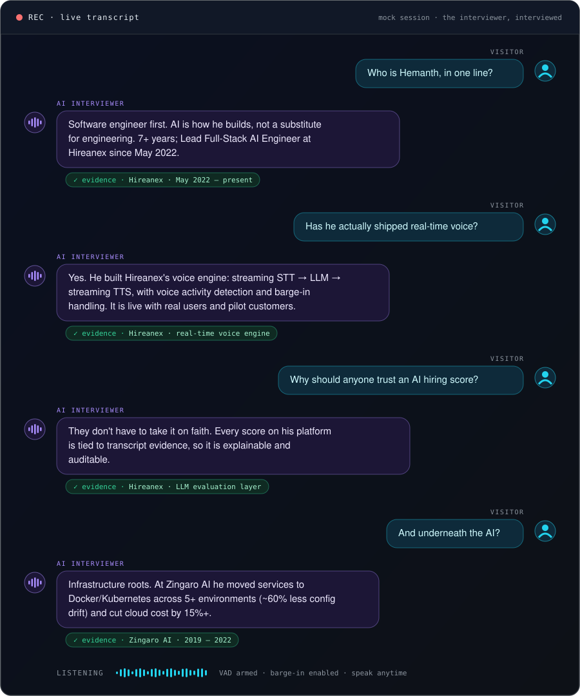
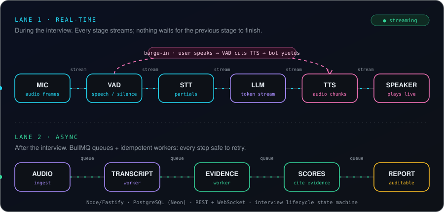
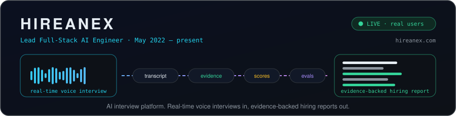
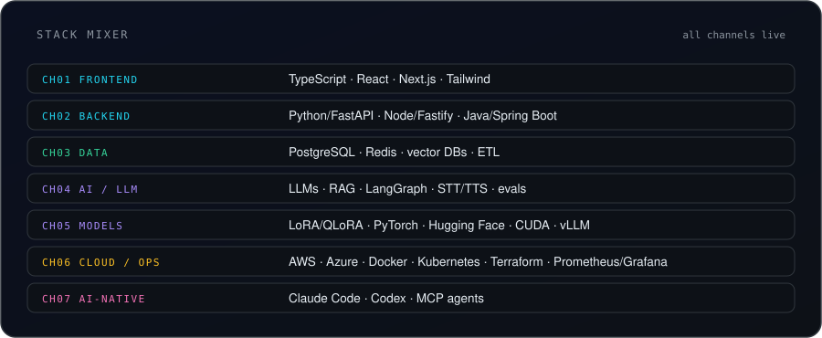

  

  
  
  
  

<h3 align="center">AI is easy to demo. Engineering is making it last — safely.</h3>

  <b>Software engineer first. AI is how I build, not a substitute for engineering.</b> 
  I build voice AI that talks to people in real time, and the systems that make what it says explainable, auditable and durable.

## 🎙️ Live transcript

A mock session. The AI interviewer gets interviewed about me, and every answer cites where it came from.

  

<b>Read the transcript as text</b>

> **Visitor:** Who is Hemanth, in one line? 
> **AI interviewer:** Software engineer first. AI is how he builds, not a substitute for engineering. 7+ years; Lead Full-Stack AI Engineer at Hireanex since May 2022. <kbd>evidence: Hireanex · May 2022 – present</kbd>
>
> **Visitor:** Has he actually shipped real-time voice? 
> **AI interviewer:** Yes. He built Hireanex's voice engine: streaming STT → LLM → streaming TTS, with voice activity detection and barge-in handling. It is live with real users and pilot customers. <kbd>evidence: real-time voice engine</kbd>
>
> **Visitor:** Why should anyone trust an AI hiring score? 
> **AI interviewer:** Every score on his platform is tied to transcript evidence, so it is explainable and auditable. <kbd>evidence: LLM evaluation layer</kbd>
>
> **Visitor:** And underneath the AI? 
> **AI interviewer:** Infrastructure roots. At Zingaro AI he moved services to Docker/Kubernetes across 5+ environments (~60% less config drift) and cut cloud cost by 15%+. <kbd>evidence: Zingaro AI · 2019 – 2022</kbd>

## ⚡ The pipeline behind the voice

  

| Lane | What it has to get right |
|---|---|
| **Real-time** | Streaming STT → LLM → streaming TTS. Voice activity detection decides when the candidate is done talking. Barge-in: if they speak over the bot, the bot stops and listens. |
| **Async** | BullMQ queues and idempotent workers turn audio → transcript → evidence → scores, so any step can be retried safely. |
| **Trust** | An LLM evaluation layer ties every score to transcript evidence, so every report is explainable and auditable. |

## 🏗️ Now: [Hireanex](https://hireanex.com)

  

**Lead Full-Stack AI Engineer · May 2022 – present.** An AI interview platform, live with real users and pilot customers.

- 🎧 **Voice engine** — streaming STT → LLM → streaming TTS, VAD, barge-in handling
- 🧱 **Backend** — Node/Fastify + PostgreSQL (Neon), REST + WebSocket APIs, an interview lifecycle state machine
- 🔁 **Pipelines** — BullMQ queues, idempotent workers: audio → transcript → evidence → scores
- 🧠 **Models** — fine-tuned open-source models with LoRA (PyTorch, Hugging Face, CUDA), served with vLLM
- 🧾 **Evals** — every score tied to transcript evidence: explainable, auditable
- 🤝 **Forward deployed** — on the ground with pilot customers: requirements, integrations into hiring workflows, feedback shipped in days
- ☁️ **Ops** — AWS, Docker, Kubernetes, Terraform, CI/CD, tests, observability
- 🤖 **AI-native workflow** — Claude Code, Codex, MCP agents. I own the architecture, the specs and the code review.

## 📼 Signal history

  

## 🎚️ Stack mixer

  

## 🕹️ Beat the voice bot

The interviewer always speaks first, so the bot has taken the center. You are **🎤**, the bot is **🔊**.
Click an empty square, then press **Submit** on the issue that opens. A GitHub Action plays the bot's reply and updates this board.

<!-- TTT:START -->

|   | 1 | 2 | 3 |
|:-:|:-:|:-:|:-:|
| **A** | [⬜](https://github.com/hemanth2416-byte/hemanth2416-byte/issues/new?title=ttt%7CA1&body=Just+press+Submit) | [⬜](https://github.com/hemanth2416-byte/hemanth2416-byte/issues/new?title=ttt%7CA2&body=Just+press+Submit) | [⬜](https://github.com/hemanth2416-byte/hemanth2416-byte/issues/new?title=ttt%7CA3&body=Just+press+Submit) |
| **B** | [⬜](https://github.com/hemanth2416-byte/hemanth2416-byte/issues/new?title=ttt%7CB1&body=Just+press+Submit) | 🔊 | [⬜](https://github.com/hemanth2416-byte/hemanth2416-byte/issues/new?title=ttt%7CB3&body=Just+press+Submit) |
| **C** | [⬜](https://github.com/hemanth2416-byte/hemanth2416-byte/issues/new?title=ttt%7CC1&body=Just+press+Submit) | [⬜](https://github.com/hemanth2416-byte/hemanth2416-byte/issues/new?title=ttt%7CC2&body=Just+press+Submit) | [⬜](https://github.com/hemanth2416-byte/hemanth2416-byte/issues/new?title=ttt%7CC3&body=Just+press+Submit) |

> 🔊 **bot:** *"Center's mine. Your turn. I'll wait for silence before I answer."*

Game #1 · move 1 · 🎤 to play

<!-- TTT:END -->

<table>
<tr>
<td valign="top" width="50%">

**📜 Last moves**

<!-- TTT-MOVES:START -->
| game | player | move | bot reply |
|:-:|---|:-:|:-:|
| 1 | 🔊 bot | B2 | — |
<!-- TTT-MOVES:END -->

</td>
<td valign="top" width="50%">

**🏆 Beat the bot**

<!-- TTT-BOARD:START -->
| player | wins | draws |
|---|:-:|:-:|
| *nobody yet* | 0 | 0 |
<!-- TTT-BOARD:END -->

</td>
</tr>
</table>

### 🗣️ Or interview the interviewer

Pick a question. The Action replies on your issue with an answer and the evidence behind it, then logs it below.

| Question | |
|---|:-:|
| 🎙️ Has he shipped real-time voice? | [<kbd>ask</kbd>](https://github.com/hemanth2416-byte/hemanth2416-byte/issues/new?title=ask%7Cvoice&body=Just+press+Submit) |
| 🧾 How are AI scores made trustworthy? | [<kbd>ask</kbd>](https://github.com/hemanth2416-byte/hemanth2416-byte/issues/new?title=ask%7Cevidence&body=Just+press+Submit) |
| 🧠 Does he fine-tune models? | [<kbd>ask</kbd>](https://github.com/hemanth2416-byte/hemanth2416-byte/issues/new?title=ask%7Cmodels&body=Just+press+Submit) |
| ☁️ What's under the AI: infra? | [<kbd>ask</kbd>](https://github.com/hemanth2416-byte/hemanth2416-byte/issues/new?title=ask%7Cinfra&body=Just+press+Submit) |
| 🤝 What does forward deployed mean for him? | [<kbd>ask</kbd>](https://github.com/hemanth2416-byte/hemanth2416-byte/issues/new?title=ask%7Cfde&body=Just+press+Submit) |
| ⚙️ How does he use AI to build? | [<kbd>ask</kbd>](https://github.com/hemanth2416-byte/hemanth2416-byte/issues/new?title=ask%7Cworkflow&body=Just+press+Submit) |

<!-- ASK:START -->
Recently asked: <i>nothing yet</i>
<!-- ASK:END -->

<b>How the game works</b>

1. Each link opens a pre-filled issue. Titles look like `ttt|A1` (a move) or `ask|voice` (a question).
2. `.github/workflows/voice-bot.yml` runs on `issues: opened` and checks the title.
3. **`ttt|<cell>`**: it validates the move against the board saved in `game/state.json`, plays the bot's reply (minimax, with a small chance of a "barge-in blunder" so it can be beaten), rewrites the block between `TTT:START` and `TTT:END`, adds a row to *Last moves*, updates the win counts on a win or draw, and starts a new game.
4. **`ask|<topic>`**: it posts the matching answer from a fixed, fact-checked answer bank (`game/answers.json`, every answer with its evidence) and adds it to *Recently asked*.
5. It comments on the issue with the result and closes it. Invalid moves get a friendly reply and nothing changes.

## 🐍 Contribution waveform

  

   
  <i>AI is easy to demo. Engineering is making it last — safely.</i>  
  <a href="https://hireanex.com">hireanex.com</a> · <a href="https://www.linkedin.com/in/hemanth-kumar-gajagiri-829497233/">LinkedIn</a>

